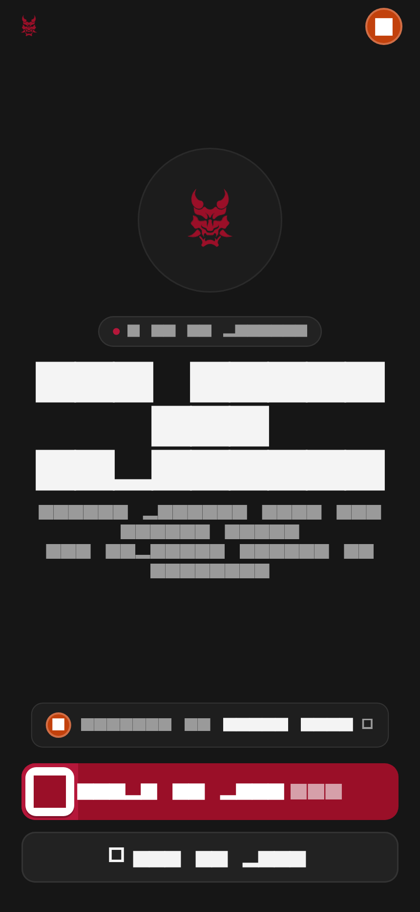
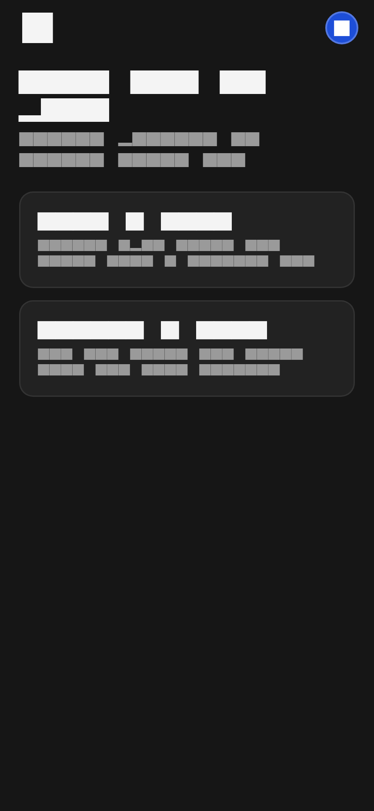
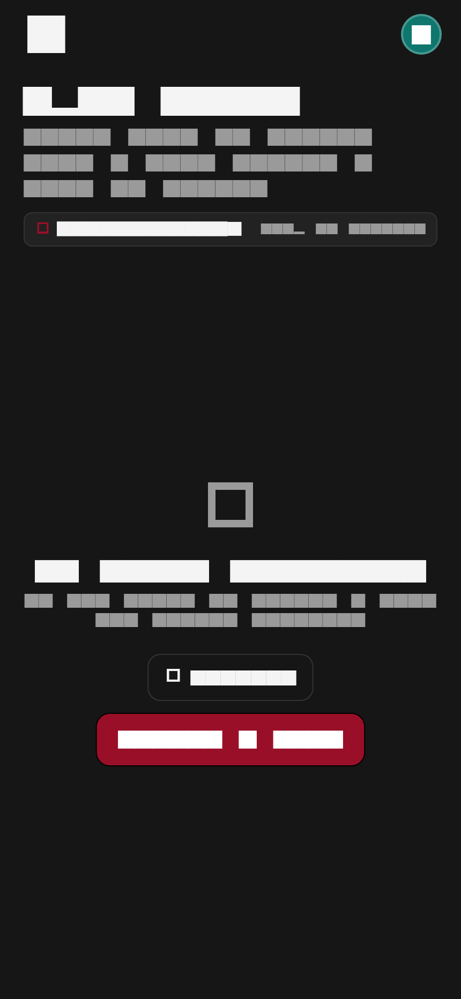
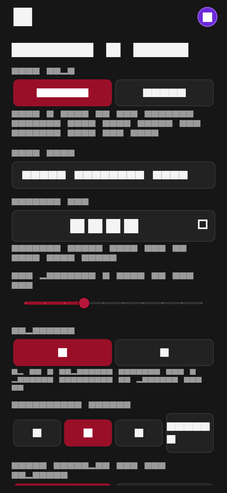
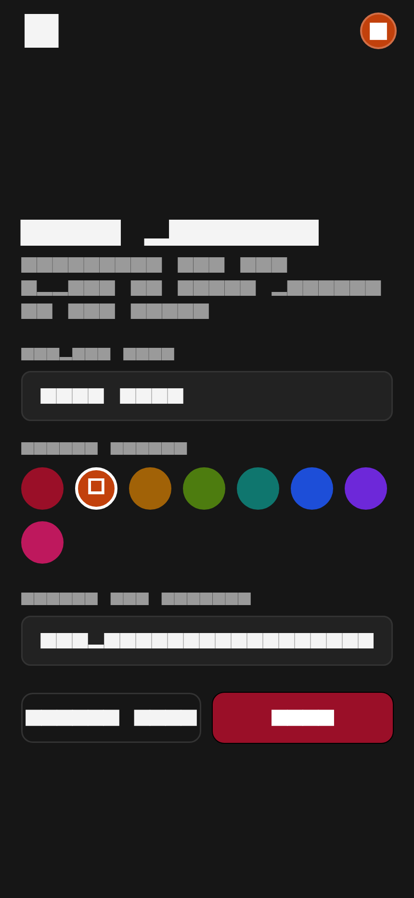
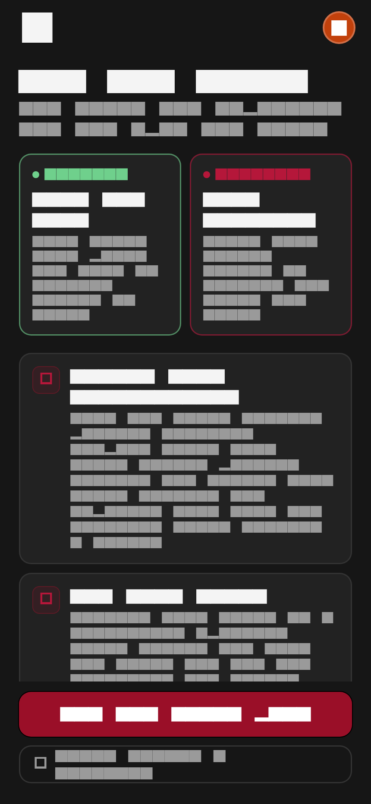
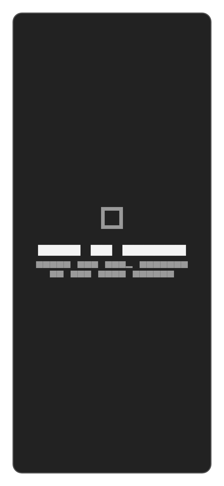
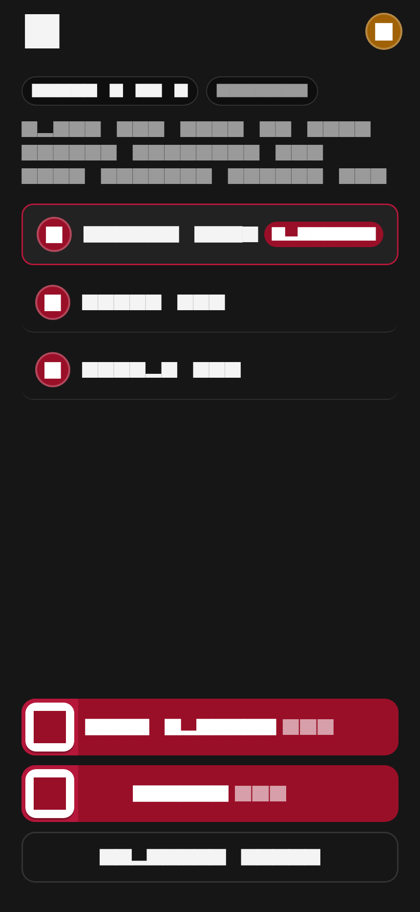
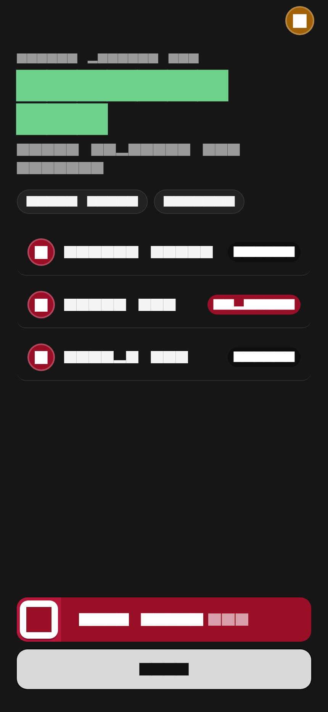

# Sus — Social Deduction Party Game

<p align="center">
  
</p>

<p align="center">
  <strong>One word. One imposter.</strong>
</p>

<p align="center">
  <em>A tense, dark, minimalist social deduction party game for 3 to 12 players.</em>
</p>

---

## Overview

**Sus** is a cross-platform social deduction game built as a production-quality monorepo featuring a **Flutter** client (Linux desktop, Android, iOS) and an authoritative **Node.js + TypeScript Socket.IO** server.

Players are assigned roles secretly: normal players receive a secret word, while the imposter receives only the category. Through round-robin clue giving, tactical bluffing, instant accusations, and high-stakes imposter word guesses, normal players strive to unmask the imposter before the imposter bluffs their way to victory or guesses the secret word!

---

## Screenshots

| Home | Mode Selection | Open Rooms |
| :---: | :---: | :---: |
|  |  |  |

| Create Game | Profile Screen | Rules & Guide |
| :---: | :---: | :---: |
|  |  |  |

| Secret Role Reveal | Local Pass & Play | Match Results |
| :---: | :---: | :---: |
|  |  |  |

---

## Core Mechanics

- **Player Count**: 3 to 12 players.
- **Roles**: Secretly assigned by the engine (1 to 3 imposters, capped so imposters remain a minority: `min(setting, max(1, floor((n-1)/2)))`).
- **Secret Distribution**: Normal players receive the secret word. Imposters receive only the category.
- **Discussion Rounds**: Fixed random speaking order. Each player gives one clue without saying the word.
- **Instant Accusation**: Any player can trigger an accusation. If an imposter is caught, they are eliminated. If a normal player is falsely accused, the accuser permanently loses their accusation privilege.
- **Imposter Guess**: At any time, an imposter can attempt to guess the secret word. A correct guess secures an immediate imposter victory.
- **Final Vote**: If rounds elapse without catching the imposter, a final group vote decides the outcome.

---

## Key Features

1. **Dual Game Modes**:
   - **Online Multiplayer**: Real-time Socket.IO rooms with 4-digit PIN locks, rate-limiting, and automatic host migration.
   - **Local Pass-and-Play**: Completely offline single-device mode with privacy handover gates and hold-to-reveal role cards.
2. **Strict Anti-Cheat Architecture**:
   - Server-authoritative state machine.
   - The secret word is **never** broadcast or leaked to imposter sockets; only unicast to normal sockets over private events.
3. **Dual Engine Parity**:
   - Pure Dart state machine in `app/lib/engine` for offline play.
   - Pure TypeScript state machine in `server/src/game` for online play.
   - Verified against shared JSON fixtures in `docs/fixtures/`.
4. **Signature Design System**:
   - Japanese oni-mask aesthetic with dark charcoal (`#161616`), panel (`#222222`), line (`#333333`), and crimson accents (`#9A0F28`).
   - Custom `SwipeToConfirm` primary interaction controls with haptic feedback.
   - Inter typography scale bundled locally as static TTF assets (no runtime Google Fonts network fetches).
   - Linux platform-safe abstraction layer (safe no-op haptics and wakelocks).

---

## Documentation

- [**Architecture & State Machine**](docs/ARCHITECTURE.md): Deep dive into the monorepo design, state transitions, security boundary, and reliability guarantees.
- [**Socket.IO Protocol**](docs/PROTOCOL.md): Full wire specification for `/game` namespace events, schemas, and error codes.
- [**Design System**](docs/DESIGN.md): Visual design tokens, typography, component guidelines, and accessibility standards.
- [**Architectural Decision Records**](docs/DECISIONS.md): ADRs documenting all technical choices.

---

## Project Structure

```
sus-game/
├── app/                      # Flutter client (Linux, Android, iOS)
│   ├── assets/               # Brand SVGs, bundled Inter fonts, offline word bank
│   ├── lib/
│   │   ├── core/             # Theme, router, platform abstractions, UI primitives
│   │   ├── engine/           # Pure Dart game state machine (zero Flutter imports)
│   │   ├── features/         # Feature modules (home, profile, rooms, lobby, games)
│   │   └── main.dart         # Client entry point
│   └── test/                 # Pure engine tests, widget tests, screenshot harness
├── server/                   # Authoritative Node.js + TypeScript server
│   ├── src/
│   │   ├── game/             # TypeScript game engine mirror
│   │   ├── rooms/            # Room manager & Argon2 PIN hashing
│   │   ├── socket/           # Socket.IO handlers & Zod validation
│   │   └── words/            # Authoritative server-side word bank
│   └── test/                 # Engine unit tests & Socket.IO integration tests
├── docs/                     # Specifications, ADRs, test fixtures, and screenshots
│   ├── fixtures/             # Shared JSON game scenario test fixtures
│   └── screenshots/          # Rendered PNG screenshots of all app views
├── Makefile                  # Build, test, and development shortcuts
└── docker-compose.yml        # Containerized server orchestration
```

---

## Getting Started

### Prerequisites

- **Node.js**: v20 LTS or higher (`npm` v10+)
- **Flutter**: 3.24+ (Channel stable) with Dart 3
- **Linux Build Dependencies** (for Linux desktop execution):
  ```bash
  sudo apt-get update && sudo apt-get install -y clang cmake ninja-build pkg-config libgtk-3-dev
  ```

### Quick Setup

Clone the repository and install all dependencies:

```bash
make setup
```

---

## Running the Project

### 1. Start the Server

```bash
# In development mode (auto-reload with tsx):
make server-dev

# Or directly with npm:
cd server
npm run dev
```
The server will start listening on port `3000` (configurable via `PORT` environment variable).

### 2. Run the Flutter App

```bash
# Run on Linux desktop:
make app-run-linux

# Or connect to a custom server during debug:
cd app
flutter run -d linux --dart-define=SERVER_URL=http://localhost:3000
```

### 3. Docker Deployment

To spin up the game server inside Docker:

```bash
make docker-up
```

---

## Verification & Testing

Every component in Sus is verified against strict testing suites:

```bash
# Run both server (vitest) and Flutter tests:
make test

# Run code linters (ESLint + flutter analyze):
make lint

# Compile the standalone Linux release bundle:
make build-linux
```

The release executable will be available at:
```bash
./app/build/linux/x64/release/bundle/sus
```

---

## License

MIT License. Designed and crafted for social gaming enthusiasts.
