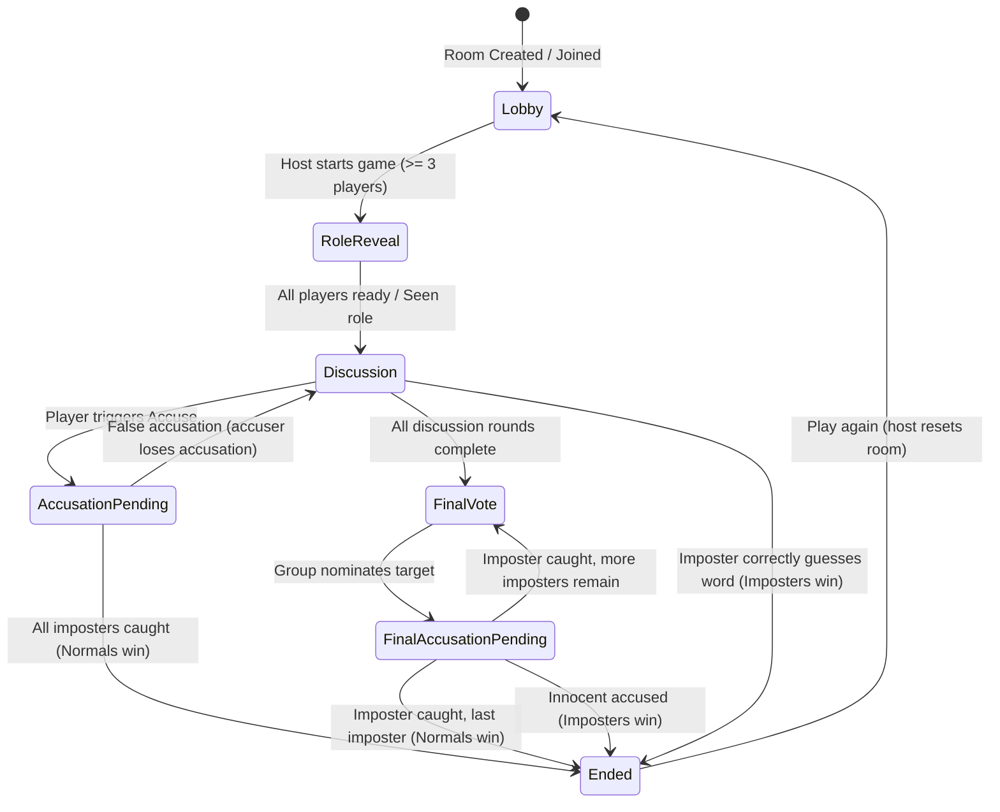

# Architecture Specification - Sus

## Overview
**Sus** ("One word. One imposter.") is a polished social-deduction party game for 3 to 12 players.
It is architected as a production-quality monorepo consisting of:
1. **Flutter Client (`app/`)**: Cross-platform application running smoothly on Linux desktop, Android, and iOS. Built with Dart 3, Riverpod 2.x code-gen, GoRouter, Freezed, and Material 3 design tokens.
2. **Web Client (`web/`)**: Modern responsive web application built with Next.js 14 App Router, TypeScript, Tailwind CSS, Lucide icons, and browser Web Audio synthesizers for zero-install instant play.
3. **Game Server (`server/`)**: Server-authoritative Node.js 20+ and TypeScript backend leveraging Socket.IO v4, Argon2 for PIN hashing, Zod schema validation, and Pino logging.
4. **Pure State Machines**: Parity state machines written in Dart (`app/lib/engine`) and TypeScript (`server/src/game` & `web/src/lib/engine`) verified against shared test fixtures in `docs/fixtures/`.

---

## Directory Structure
```
sus-game/
├── app/
│   ├── lib/
│   │   ├── main.dart
│   │   ├── app.dart
│   │   ├── core/
│   │   │   ├── errors/         # Typed Failure classes
│   │   │   ├── platform/       # Desktop-safe platform abstractions (haptics, wakelock)
│   │   │   ├── router/         # GoRouter configuration
│   │   │   ├── theme/          # SusColors ThemeExtension, Inter typography, ThemeData
│   │   │   ├── utils/          # Word filtering, name generation, PIN helpers
│   │   │   └── widgets/        # SwipeToConfirm, RoleCard, PlayerAvatar, OniMask, PinField, etc.
│   │   ├── engine/             # Pure Dart offline game state machine (no Flutter dependencies)
│   │   ├── features/
│   │   │   ├── home/           # Landing screen with Oni mask and SwipeToConfirm Play
│   │   │   ├── mode/           # Online vs Local mode selector
│   │   │   ├── profile/        # Dedicated profile page and state
│   │   │   ├── rules/          # Dedicated rules page
│   │   │   ├── legal/          # Terms of Service, Privacy Policy, Legal Notice
│   │   │   ├── rooms/          # Online open rooms browser, PIN sheet
│   │   │   ├── create_game/    # Online & Local configuration form
│   │   │   ├── lobby/          # Online game lobby, player list, host settings
│   │   │   ├── online_game/    # Server-authoritative game flow (role reveal, turn clues, accuse)
│   │   │   ├── local_game/     # Local pass-and-play game flow with device handover
│   │   │   └── results/        # Victory celebration, word reveal, player roles
│   │   └── l10n/               # ARB internationalization files
│   ├── assets/
│   │   ├── brand/              # mask.svg logo
│   │   ├── fonts/              # Inter-Regular, Inter-Medium, Inter-Bold, Inter-ExtraBold
│   │   └── words/              # Comprehensive offline word bank (JSON)
│   └── test/                   # Unit, widget, golden, and integration tests
├── web/
│   ├── src/
│   │   ├── app/                # Next.js App Router (home, play, rules, download, legal)
│   │   ├── components/         # Navbar, Footer, UI components
│   │   └── lib/
│   │       ├── audio/          # Web Audio API procedural sound synthesizer
│   │       ├── engine/         # Pure TypeScript client game engine
│   │       └── socket/         # Socket.IO connection manager and React hook
│   ├── public/                 # Static branding assets (mask.svg)
│   └── Dockerfile
├── server/
│   ├── src/
│   │   ├── config.ts           # Typed environment configuration
│   │   ├── index.ts            # Entrypoint & HTTP / Socket.IO server initialization
│   │   ├── game/               # Pure TypeScript game state machine (parity with Dart engine)
│   │   ├── rooms/              # Room manager, argon2 PIN verification, lifecycle
│   │   ├── socket/             # Socket.IO handlers, zod payload validation, unicast roles
│   │   ├── words/              # Server-authoritative word bank (categories, words, clues)
│   │   └── util/               # Rate limiters, token generators, sanitize utilities
│   ├── test/                   # Vitest unit & socket integration tests
│   ├── Dockerfile
│   └── docker-compose.yml
├── docs/
│   ├── ARCHITECTURE.md
│   ├── PROTOCOL.md
│   ├── DECISIONS.md
│   ├── DESIGN.md
│   └── fixtures/               # Shared JSON fixtures replayed by both engine test suites
├── .github/workflows/ci.yml
├── Makefile
└── README.md
```

---

## State Flow & Phase State Machine
Game phases are modeled as an immutable union/sealed state:


---

## Security & Anti-Cheat Boundary
- In **Online Mode**, client application instances never determine role assignment, secret word selection, turn advancement, or victory outcomes.
- Secret separation guarantee:
  1. Unrevealed roles are excluded from `room:state`.
  2. The secret word is strictly unicast via `game:role` only to sockets whose role is `normal`.
  3. Imposters receive only category metadata.
  4. Word checking on clues strips punctuation and case before checking against secret word substrings.

---

## Performance & Linux Desktop Compatibility
- Strict 60+ FPS design with const constructors, granular Riverpod `.select()`, and virtualized list builders.
- Platform service interfaces ensure features like haptic feedback safely no-op on Linux.
- Minimum window geometry enforcement (360x640) and responsive centered column (max-width 480px) ensure great UI presentation across all screens.
